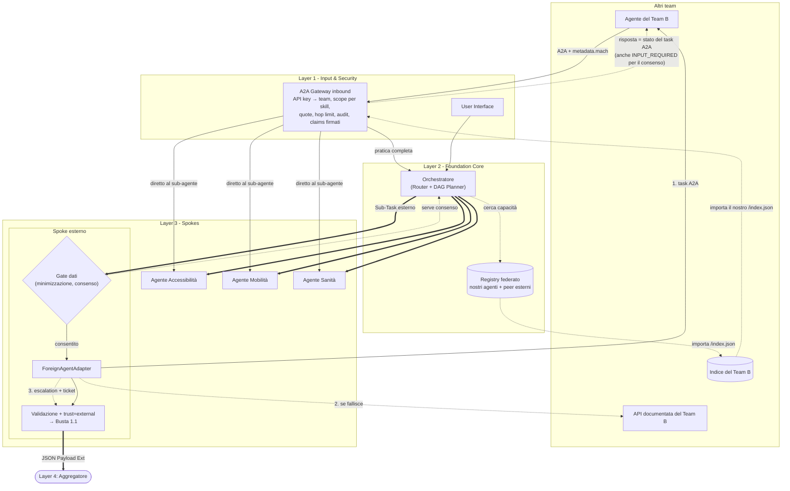

# Architettura: schema v2, decisioni e interoperabilità con gli altri team

Questo documento riunisce l'analisi dello schema v2 di Giovanni (17–18/11/2026), la relativa Architecture Review (rilievi A–J) e la mappa delle decisioni sul codice.

Schema completo: [ARCHITETTURA_SCHEMA_V2.mmd](ARCHITETTURA_SCHEMA_V2.mmd). È in Mermaid e si apre su GitHub o su mermaid.live.

> **Aggiornamento 19/11 (whitepaper).** All'hackathon conta un agente PoC ben fatto, registrato sul nodo di Milano e capace di interagire con gli altri team. Lo schema v2 resta la visione da raccontare nel pitch; i Layer 4–5 completi probabilmente non vanno costruiti. Vedi [HACKATHON_PLAYBOOK.md](HACKATHON_PLAYBOOK.md).

## Cosa cambia rispetto alla v1

- **Layer 1**: nuovo "A2A API Gateway (inbound da altri team)", che entra in Identity & Security, con l'etichetta "MACH Interop Protocol".
- **Layer 2**: terzo sub-task, "Sub-Task (MACH Protocol)", verso lo spoke esterno.
- **Layer 3**: nuovo spoke "Ente Esterno (Foreign Team Cartridge)". Lo compongono Foreign Agent Adapter, Interop Tools, "Richiamo API Team Esterno (se disponibile)", "RPA su App Team Esterno (API sniffing & DOM parsing)", Discovery Fallback, JSON Formatter e "JSON Payload Ext".
- **Layer 4 e 5**: invariati.

## La decisione: "porta unica, indirizzi multipli"

**Domanda.** Le richieste degli altri team devono passare sempre dall'orchestratore (gateway del Layer 1 → Layer 2)? Oppure, come in NANDA, gli altri team parlano direttamente con i nostri sub-agenti, trovati in un indice?

**Risposta: entrambe le cose, separando due responsabilità che lo schema unisce.**

| | Solo via orchestratore | Solo diretto agli agenti | **Ibrido (scelto)** |
|---|---|---|---|
| Discovery | gli altri vedono un solo agente generico | vedono ogni capacità | ogni capacità nell'indice, più l'orchestratore per le pratiche complete |
| Collo di bottiglia | l'orchestratore (LLM, latenza, punto unico di guasto) | nessuno | nessuno |
| Sicurezza e audit | centralizzati | sparsi in ogni agente | centralizzati nel gateway, ripetuti negli agenti |
| Consenso per agenti esterni | da inventare nel Layer 4 | da gestire in ogni agente | regola unica del profilo MACH (INPUT_REQUIRED + `metadata.mach.consent`) |
| Spirito NANDA | basso | alto | alto |

- **Indirizzi multipli.** Ogni agente di servizio (Accessibilità, Mobilità, Sanità, Ambiente) è pubblicato nell'indice, con la sua Agent Card e il suo URL pubblico (`<gateway>/agents/<nome>/`). Per una domanda su un solo dominio ("questa sede è accessibile?") un altro team chiama direttamente l'Agente Accessibilità, senza passare dall'orchestratore. Anche l'orchestratore va pubblicato come agente, con una skill per le pratiche multi-ente.
- **Porta unica.** Tutto il traffico esterno passa dal gateway inbound, un reverse proxy. Il gateway **non decide il percorso**: non è un orchestratore. Applica identità del team, scope per skill, quote, limite di passaggi (hop), isolamento dei task e audit. Gli agenti ricontrollano i permessi tramite claims firmati, così il sistema resta sicuro anche se qualcuno raggiunge un agente senza passare dal gateway.
- **Consenso.** Le skill con effetti reali (es. `prenota`) richiedono il consenso nel messaggio. Se manca, l'agente risponde INPUT_REQUIRED.

## "Protocollo MACH" = profilo di A2A 1.0

Non è un protocollo nuovo: è A2A 1.0 più alcune convenzioni nostre, dichiarate come estensione nella Agent Card. Le regole complete, da passare agli altri team, sono in [PROTOCOLLO_MACH.md](PROTOCOLLO_MACH.md).

- Richieste strutturate come DataPart `{skill, args}`.
- `metadata.mach` = {trace_id, hops, caller, deadline, consent}.
- Output nella Busta 1.1 (`contracts/`).
- Discovery: registry federato + NANDA Index (AI Catalog, AgentFacts firmati).

## Schema delle parti toccate (Layer 1–3)

## Rilievi della Architecture Review: correzioni e stato

Giudizio della review: l'idea è giusta, ma i percorsi nuovi sono disegnati solo in andata. 10 rilievi nuovi, di cui 6 gravi.

| Id | Rilievo | Correzione | Stato | Dove |
|---|---|---|---|---|
| A | Un agente che chiama non riceve risposta (i ritorni vanno tutti alla UI) | Ogni esito torna al canale d'origine come stato del task A2A | ✅ | `gateway/server.py`, `a2a_lite/` |
| B | Nessuno può dare il consenso se il chiamante è un agente | Approvatore = la persona dietro l'agente (via INPUT_REQUIRED) o un mandato; il consenso torna con `granted_by` user/mandate | ✅ lato agenti | `agents/base.py`, `interop/mach.py` |
| C | Un solo controllo d'identità per utenti e agenti | API key per team, scope per skill, scritture solo con scope esplicito, quote, card filtrate | ✅ | `gateway/` |
| D | Due nomi per il protocollo ("A2A" e "MACH") | MACH = profilo di A2A 1.0, dichiarato come estensione | ✅ | `docs/PROTOCOLLO_MACH.md` |
| E | Nessuna protezione dai loop tra team | trace_id + hops + deadline, controllati da gateway e agenti | ✅ | `interop/mach.py` |
| F | Lo spoke esterno non usa il protocollo di cui porta il nome | Prima task A2A, poi API documentata, poi escalation | ✅ | `interop/foreign.py` |
| G | Fallback via scraping delle app dei partner | Eliminato: solo operazioni dichiarate | ✅ | `interop/http_api.py` |
| H | Dati dell'utente escono prima del consenso | Gate prima dell'invio, campi mai condivisibili, log delle condivisioni | ✅ | `interop/policy.py` |
| I | I risultati esterni entrano nell'Aggregatore come quelli interni | Validazione, `trust=external`, confidence ≤ 0,8, testo ripulito, segnalazione di possibili prompt injection, azioni esterne scartate | ✅ | `interop/foreign.py`, `contracts/` |
| J | Il Layer 5 non sa agire tramite il team esterno | Step "task A2A delegato" nella Saga; compensazione = cancel del task | 🟡 pronti `ExternalHandle`, `resume()` e `cancel()`; lo step nella Saga va scritto da chi fa il Layer 5 | `interop/foreign.py` |
| 22 | Audit e osservabilità | Audit del gateway (JSONL + eventi al registry) e trace_id tra team | 🟡 manca una vista unica | `gateway/`, `registry/` |

Restano per gli altri del team i rilievi del Layer 4/5 (14–21) e la UI del consenso. Il formato con cui il consenso arriva agli agenti è già definito (`metadata.mach.consent`).

## Cosa fare il primo giorno di gara (interoperabilità)

1. Chiedere agli organizzatori se esiste un indice comune. Se sì, aggiungerlo come peer (`POST /peers`) o adattare `registry/client.py`.
2. Pubblicare il gateway su un URL raggiungibile (IP della rete o tunnel) e impostare `public_url` in `gateway/config.example.json`.
3. Dare agli altri team l'URL del gateway, `docs/PROTOCOLLO_MACH.md` e una API key con i loro scope.
4. Raccogliere le card o gli indici degli altri team e importarli (`POST /import` o `POST /peers`).
