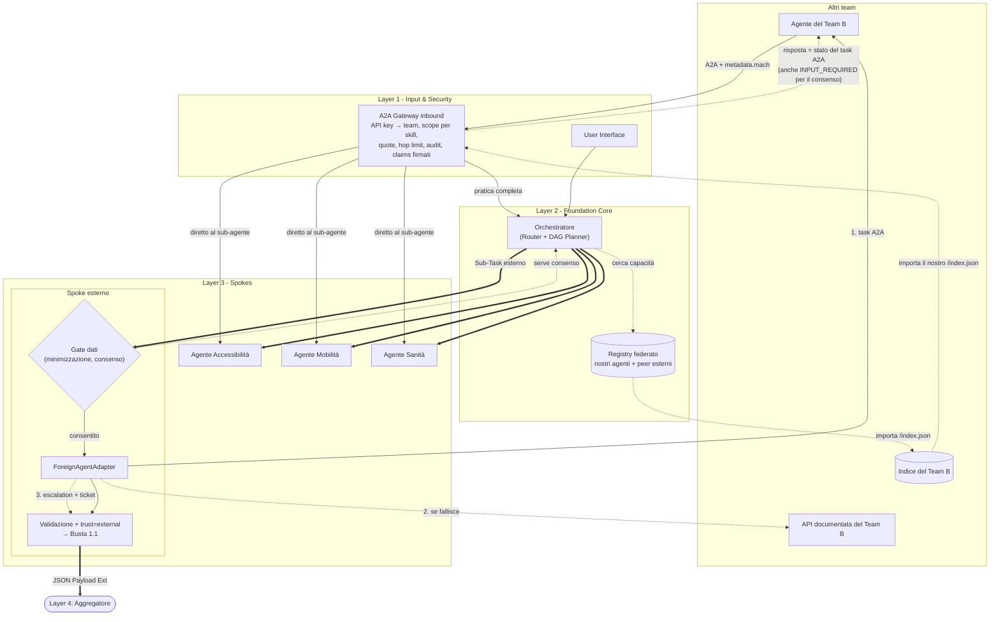

# Interoperabilità con gli altri team: decisioni e mappa sul codice

Fa riferimento allo schema di Giovanni v2 e alla relativa Architecture Review (rilievi A–J).

## La decisione: "porta unica, indirizzi multipli"

**Domanda.** Le richieste degli altri team devono passare sempre dall'orchestratore (gateway del Layer 1 → Layer 2), oppure, come in NANDA, gli altri team parlano direttamente con i nostri sub-agenti trovati in un indice?

**Risposta: entrambe le cose, separando due responsabilità che lo schema unisce.**

| | Solo via orchestratore | Solo diretto agli agenti | **Ibrido (scelto)** |
|---|---|---|---|
| Discovery | gli altri vedono un solo agente generico | vedono ogni capacità | ogni capacità nell'indice, più l'orchestratore per le pratiche complete |
| Collo di bottiglia | l'orchestratore (LLM, latenza, punto unico di guasto) | nessuno | nessuno |
| Sicurezza e audit | centralizzati | sparsi in ogni agente | centralizzati nel gateway, ripetuti negli agenti |
| Consenso per agenti esterni | da inventare nel Layer 4 | da gestire in ogni agente | regola unica del profilo MACH (INPUT_REQUIRED + `metadata.mach.consent`) |
| Spirito NANDA | basso | alto | alto |

- **Indirizzi multipli.** Ogni sub-agente ha la sua card e il suo URL pubblico (`<gateway>/agents/<nome>/`) ed è nell'indice. Per una domanda di un solo dominio ("questa sede è accessibile?") un altro team chiama direttamente l'Agente Accessibilità: l'orchestratore non serve. Anche l'orchestratore va pubblicato come agente, per chi vuole il servizio completo multi-ente.
- **Porta unica.** Tutto il traffico esterno passa dal gateway. Il gateway **non decide il percorso** (non è un orchestratore): applica identità, scope, quote, limite di passaggi, isolamento dei task e audit. Gli agenti ricontrollano i permessi tramite claims firmati, così il sistema resta sicuro anche se qualcuno raggiunge un agente senza passare dal gateway.

## Schema delle parti toccate (Layer 1–3)

## Rilievi della review: cosa è risolto e dove

| Rilievo | Stato | Dove |
|---|---|---|
| A: l'agente che chiama non riceve risposta | ✅ ogni esito torna come stato del task A2A al chiamante | `gateway/server.py`, `a2a_lite` |
| B: nessuno dà il consenso se chiama un agente | ✅ lato agenti: INPUT_REQUIRED con l'azione proposta; il consenso strutturato torna con `granted_by` user/mandate | `agents/base.py`, `interop/mach.py` |
| C: un solo controllo d'identità | ✅ API key per team, scope per skill, scritture solo con scope esplicito, quote, card filtrate | `gateway/` |
| D: due nomi per il protocollo | ✅ "MACH" = profilo di A2A 1.0, documentato e dichiarato come estensione | `docs/PROTOCOLLO_MACH.md` |
| E: loop tra team | ✅ trace_id + hops + deadline, controllati da gateway e agenti | `interop/mach.py` |
| F: lo spoke esterno non usa il protocollo | ✅ A2A → API documentata → escalation | `interop/foreign.py` |
| G: scraping delle app dei partner | ✅ eliminato: solo operazioni dichiarate | `interop/http_api.py` |
| H: dati che escono prima del consenso | ✅ gate prima dell'invio, campi mai condivisibili, log delle condivisioni | `interop/policy.py` |
| I: risultati esterni trattati come interni | ✅ validazione, `trust=external`, confidence ≤ 0,8, testo ripulito, segnalazione di possibili prompt injection, azioni esterne scartate | `interop/foreign.py`, `contracts/` |
| J: il Layer 5 non agisce tramite il team esterno | 🟡 pronti `ExternalHandle`, `resume()` e `cancel()` (compensazione); lo step nella Saga va scritto da chi fa il Layer 5 | `interop/foreign.py` |
| 22: audit e osservabilità | 🟡 audit del gateway (JSONL + eventi al registry) e trace_id tra team; manca una vista unica | `gateway/`, `registry/` |

Restano per gli altri del team i rilievi del Layer 4/5 (14–21) e la UI del consenso: il formato con cui il consenso arriva agli agenti è già definito (`metadata.mach.consent`).

## Cosa fare il primo giorno di gara
1. Chiedere agli organizzatori se esiste un indice comune. Se sì: aggiungerlo come peer (`POST /peers`) o adattare `registry/client.py`.
2. Pubblicare il gateway su un URL raggiungibile (IP della rete o tunnel) e impostare `public_url` in `gateway/config.example.json`.
3. Dare agli altri team: l'URL del gateway, `docs/PROTOCOLLO_MACH.md` e una API key con i loro scope.
4. Raccogliere le card o gli indici degli altri team e importarli (`POST /import` o `POST /peers`).
